<p align="center"><picture><source media="(prefers-color-scheme: dark)" srcset="docs/brand/logo-dark.png"></picture></p>

<h1 align="center">PAM: Payment Account Manager</h1>

<p align="center"><b>What did we really spend, what repeats, and are we inside budget?</b><br>
A household finance register for Indian UPI, bank and card transactions: web console, Android app and API.</p>

<p align="center">
<a href="https://github.com/vbs-0/pam/actions/workflows/ci.yml"></a>


</p>

<p align="center">
<a href="https://pam.is-cool.dev"><b>Live demo</b></a> ·
<a href="https://pam.is-cool.dev/downloads/pam.apk"><b>Android APK</b></a> ·
<a href="https://pam.is-cool.dev/docs">API docs</a> ·
<a href="docs/features.md">Feature list</a> ·
<a href="docs/screenshots.md">All screenshots</a> ·
<a href="https://github.com/vbs-0/pam/releases">Releases</a>
</p>

<p align="center"><picture><source media="(prefers-color-scheme: dark)" srcset="docs/screenshots/web/02d-home-dark.png">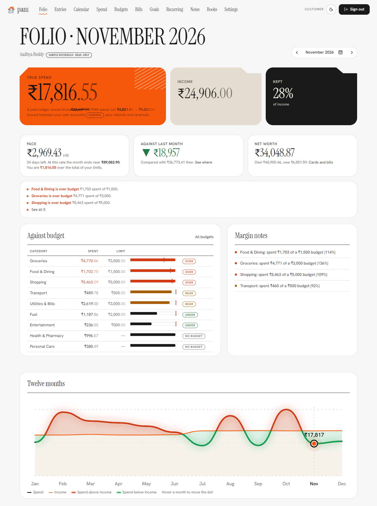</picture></p>

PAM turns a household's bank and UPI transactions into answers to three questions. It categorizes every transaction, maps recurring payments (salary, rent, EMIs, subscriptions, bills), and compares spending with monthly budgets. Everything it decides is traceable to a rule, a version and a confidence, and every exception goes to a human queue.

Indian context throughout: UPI/IMPS/NEFT/card channels, amounts in integer **paise**, business dates in **IST**, UTC storage.

**Try it now:** open the [live demo](https://pam.is-cool.dev) and sign in as `usr-000001@pam.is-cool.dev` / `password123` for a read-only sample household, or create an account (email or Google) for your own empty household: savings accounts, credit cards and UPI apps (PhonePe, Google Pay, Paytm, BHIM, Amazon Pay or your own name).

## Highlights

| | |
|---|---|
| **True spend, not naive spend** | Own-account transfers, card-bill payments, refunds and UPI reversals are matched and left out, so the headline figure is what the household actually spent (naive ledger: +129% too high on the starter data, PAM: 0%). |
| **Every decision is explainable** | Rule id, version, confidence and override history on every transaction; append-only audit log; trace view for analysts and reviewers. |
| **Remember my choice, optional AI** | Fix one category and similar entries follow. Optional Gemini sorting sends only masked narration and applies visible, reversible overrides. |
| **Works offline** | The Android app and the web PWA queue changes safely and sync silently when the network returns; idempotency keys make retries safe. |
| **Four roles** | Customer, analyst, reviewer and admin consoles, each with only its own screens. |
| **Reproducible data** | Fixed seed, byte-identical regeneration, 22 dataset checks, nine output checks, evaluation against hidden ground truth. |

## Screens

**Web console** (light and dark, desktop first, installable PWA)

| Folio | Entries | Budgets |
|---|---|---|
|  | 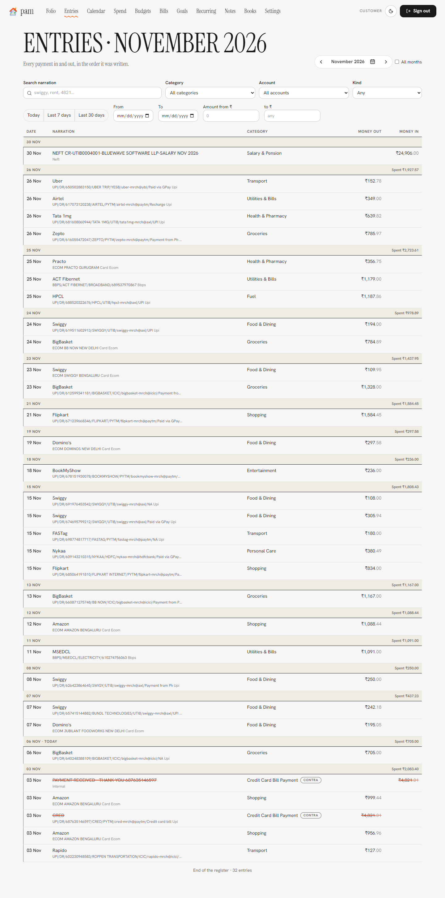 | 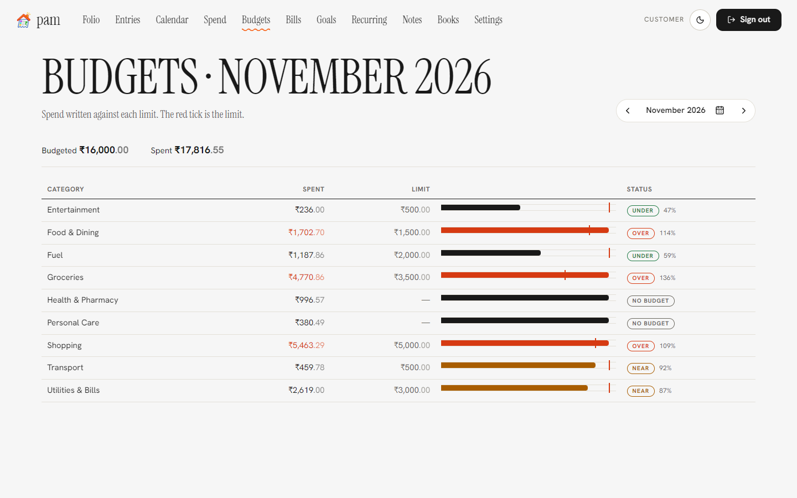 |
| **Recurring** | **Calendar** | **Spend** |
| 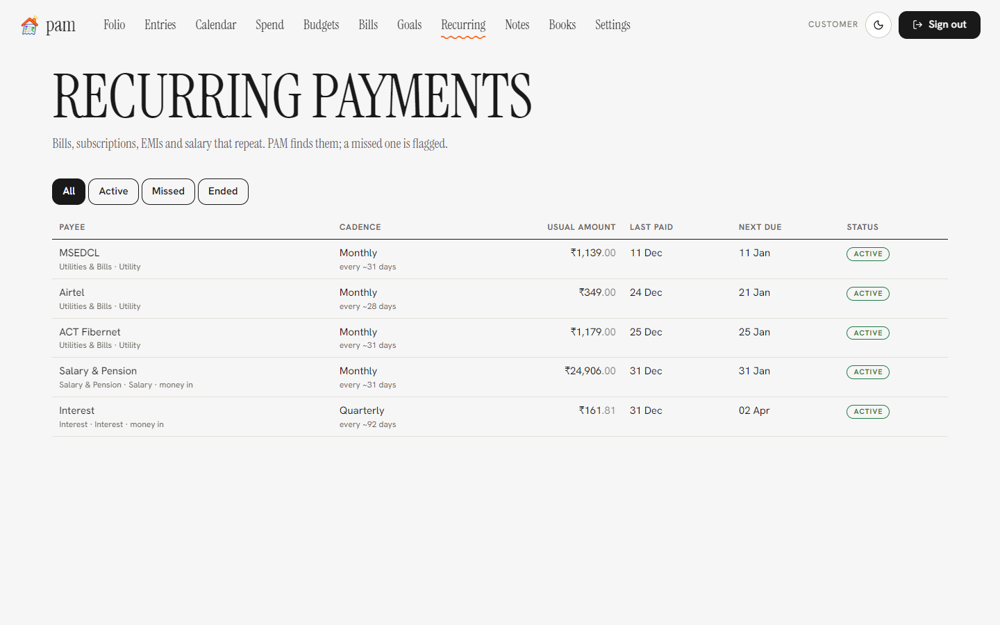 | 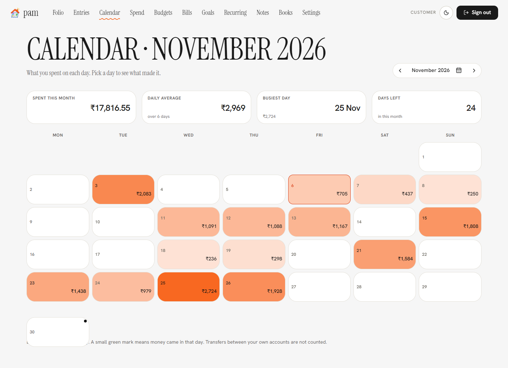 | 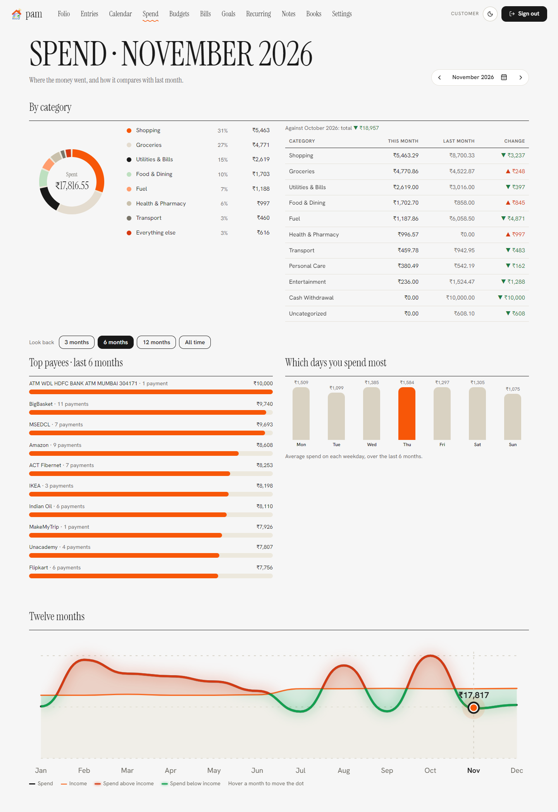 |

**Staff consoles**

| Exceptions (analyst) | Metrics (analyst) | Anomalies (reviewer) | Admin jobs |
|---|---|---|---|
| 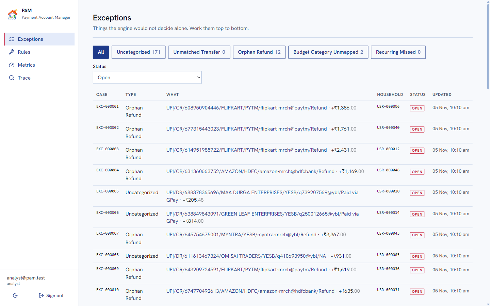 | 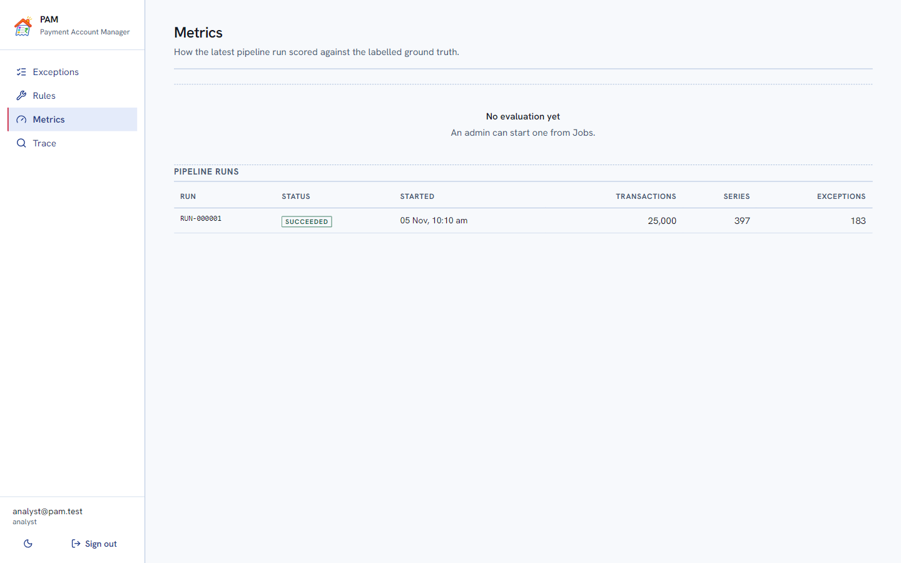 | 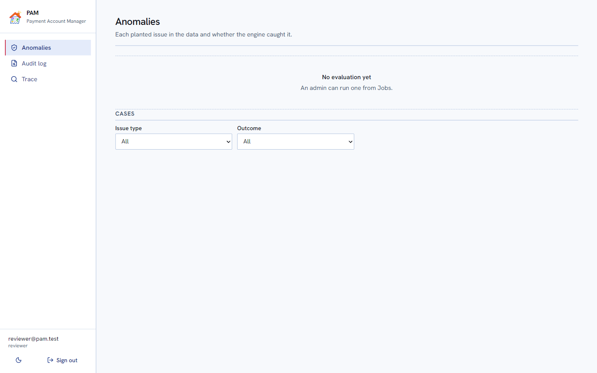 | 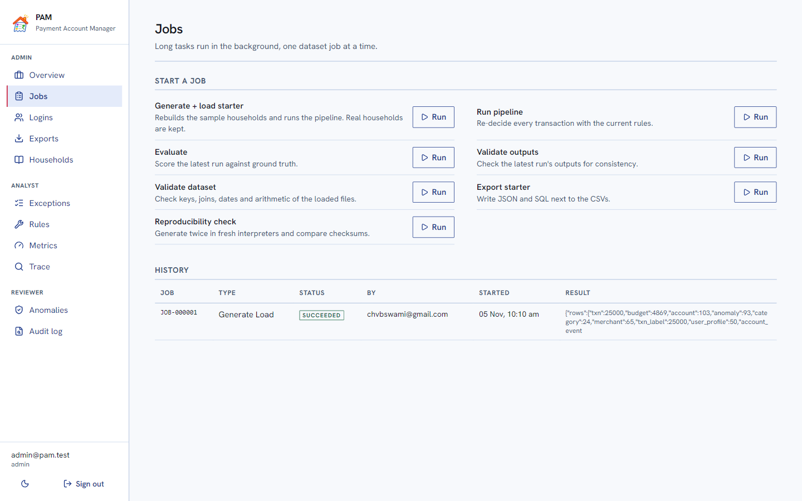 |

**Android app** (offline-first, three home-screen widgets)

| Home | Entries | Calendar | Spend | Budgets | Dark |
|---|---|---|---|---|---|
| 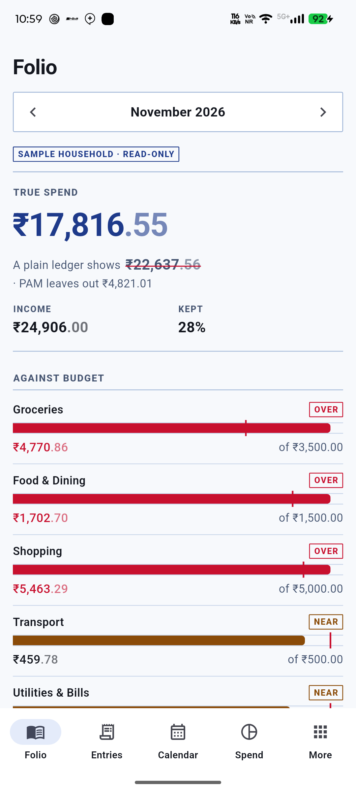 | 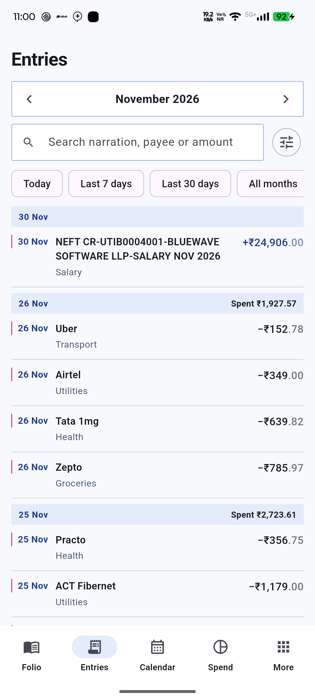 | 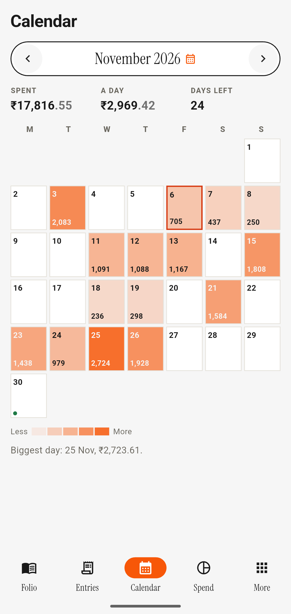 | 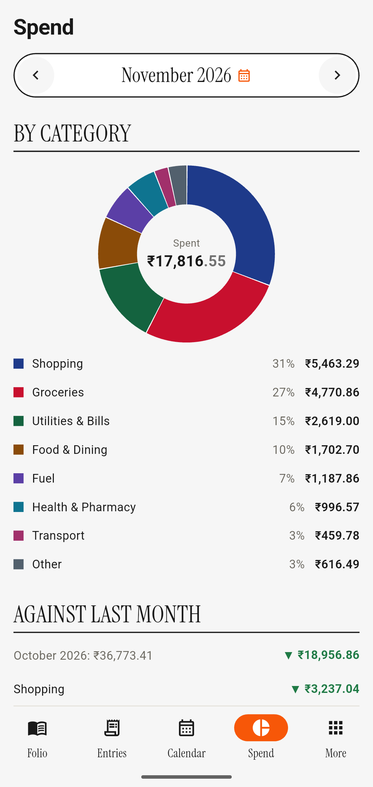 | 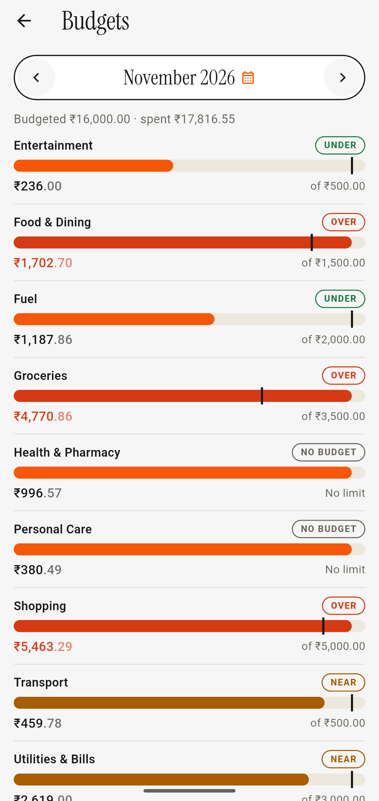 | 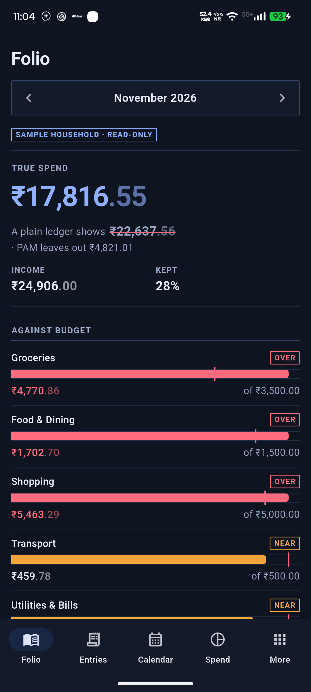 |

Every screen: [docs/screenshots.md](docs/screenshots.md). Everything the product does, read from the code: [docs/features.md](docs/features.md).

## How it fits together

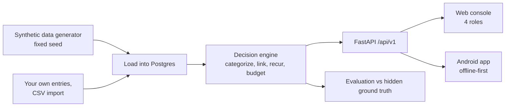

## Repository layout

```text
pam/
├── backend/            FastAPI app, engine, data generator, jobs, migrations, tests
│   ├── app/{api,engine,datagen,jobs}/
│   ├── migrations/     Alembic 0001..0006
│   └── tests/{api,engine,datagen,jobs}/
├── web/                React 19 + Vite + Tailwind console, PWA (src/pages/{customer,staff,admin})
├── mobile/             Flutter Android app, widgets, offline outbox
├── data/starter/       committed dataset: 50 households, 25,000 transactions
├── reports/            validation, evaluation, reproducibility (starter and full)
├── docs/               data dictionary, edge cases, deploy, AI disclosure, screenshots
├── deploy/             systemd unit, nginx site, deploy script
└── .github/workflows/  CI and continuous deployment
```

## What is in the repo (details)

| Path | What |
|---|---|
| `backend/` | FastAPI + Postgres. Data generator, decision engine, jobs, REST API, Alembic migrations, 200+ tests |
| `web/` | React 19 + Vite + Tailwind console for all four roles (customer, analyst, reviewer, admin), light and dark |
| `mobile/` | Flutter Android app for customers: folio, entries with filters, calendar heatmap, spend analytics, budgets with rollover, bills and net worth, goals, CSV import, export and backup, household sharing, offline copy, three home-screen widgets; email and Google sign-in |
| `data/starter/` | The starter dataset: 50 households, 25,000 transactions (committed) |
| `reports/` | Validation, evaluation and reproducibility reports for starter and full scale |
| `docs/` | Data dictionary, edge-case register, infrastructure and deploy notes, AI disclosure, prompt history |
| `deploy/` | systemd unit, nginx site, deploy script |
| `.github/` | CI (backend tests, web build and tests, Flutter analysis) and automatic deployment to the server after CI passes on `main` ([docs/deploy.md](docs/deploy.md)) |

The full dataset (1,000 households, 500,000 transactions, seed `20261022`, ~500 MB) is not committed, but the complete files are attached to the [v1.1.0 release](https://github.com/vbs-0/pam/releases/tag/v1.1.0) as a 67 MB zip, and `python -m app.cli generate --scale full` recreates them byte for byte; its manifest, provenance record and reports are in `reports/full/`. The data is synthetic only; see [docs/dataset-provenance.md](docs/dataset-provenance.md) for provenance, tamper checks (`docs/manifest-hashes.sha256`) and the exact reproducibility scope (locked Python 3.12 and `backend/uv.lock`). Generated files are never edited by hand.

## Try it as each role

Live site: log in with the password the author gives you (not stored in the repo) or run locally and set `DEMO_PASSWORD` in `backend/.env`. The seeded accounts are `customer@pam.test`, `analyst@pam.test`, `reviewer@pam.test` and `admin@pam.test`, all with `DEMO_PASSWORD`. Each sees only its own screens.

## Run it

Needs Python 3.12 with [uv](https://docs.astral.sh/uv/), Node 20+, Postgres 14+. Flutter is only for the mobile app.

```bash
# once: create the Postgres role and two databases (psql as a superuser)
#   CREATE ROLE pam LOGIN PASSWORD 'pam'; CREATE DATABASE pam OWNER pam; CREATE DATABASE pam_test OWNER pam;
cd backend
cp .env.example .env            # set DATABASE_URL, JWT_SECRET, DEMO_PASSWORD
uv sync
uv run alembic upgrade head
uv run python -m app.cli all --scale starter     # generate, validate, load, run engine, evaluate, validate outputs
uv run uvicorn app.main:app --port 8000          # API on :8000, docs at /docs
cd ../web && npm install && VITE_API_TARGET=http://localhost:8000 npm run dev
```

On Windows PowerShell use `copy .env.example .env` and `$env:VITE_API_TARGET="http://localhost:8000"; npm run dev`.

Verify key behaviour:

```bash
cd backend && uv run pytest -q                    # 200+ tests
uv run python -m app.cli repro --scale starter    # two fresh generations must have identical checksums
cat ../reports/starter/evaluation.md              # metrics against acceptance targets
```

Optional settings: SMTP (`SMTP_*`, for password-reset and welcome email), Google sign-in (`FIREBASE_PROJECT_ID`, `VITE_FIREBASE_*`, `google-services.json`). Each is documented in `backend/.env.example`, `web/.env.example` and [`docs/deploy.md`](docs/deploy.md); everything works without them except those two features.

Mobile: `cd mobile && flutter build apk --release` (set `--dart-define=API_BASE=...` to point at another server). Release signing reads a git-ignored `android/key.properties`; without it the build falls back to the debug key.

## How it works

1. **Generate.** A seeded generator (`seed 20261022`) writes master data first (categories, merchants, users, accounts), then dependent records with valid parent ids, then ground-truth labels derived from the same rules rather than random draws.
2. **Decide.** The engine runs in a fixed order: categorize (rules, versioned, with confidence) → apply human overrides → link refunds to original purchases → match transfers between a household's own accounts → detect recurring series and missed payments → budgets, insights and exceptions. Ids are stable (`REC-`, `EXC-`), so a re-run does not duplicate or lose history.
3. **Expose.** Customers see true spend (transfers, contra and reversed rows struck out of the total), budget versus actual, recurring payments and margin notes. Analysts work the exception queue, edit and test rules, and see engine metrics. Reviewers see anomalies and the audit log. Admins run jobs, validation, reproducibility checks, exports and user management.
4. **Persist history.** Overrides, rule versions, exception transitions, account events and audit entries are appended, never overwritten.

## Results

| Metric (full scale, 500,000 txns) | Result | Target |
|---|---|---|
| Category accuracy | 97.99% | ≥ 85% |
| Transfer F1 | 1.000 | ≥ 0.95 |
| Refund link recall | 0.909 | ≥ 0.90 |
| Timezone-boundary month accuracy | 1.000 | = 1.0 |
| Budget/category mismatch handling | 1.000 | = 1.0 |
| Recurring series recall | 0.9995 | ≥ 0.85 |
| Missed-payment precision / recall | 0.96 / 1.00 | ≥ 0.80 |
| Decoy false-alarm rate | 0.000 | ≤ 0.10 |

Per-issue recall: transfer double-count 400/400, TZ boundary 400/400, budget mismatch 200/200, recurring skip 120/120, recurring-not-skip 240/240, refund-as-expense 465/500. Full tables: `reports/full/evaluation.md`. Evaluation excludes real (user-entered) households, which have no ground truth.

## Decisions and trade-offs

- **Paise as integers, IST business dates, UTC storage.** No floats near money; a 23:50 IST payment lands in the right month (the TZ-boundary cases exist to prove it).
- **Rules over a model.** Rules are explainable, versioned and testable by an analyst before release. The cost is coverage: 99.26% of transactions get a category, the rest go to the exception queue instead of a guess.
- **Postgres + in-process jobs.** One 1 GB server, so no Redis or queue. Jobs run in threads, a single-flight advisory lock stops overlapping runs, orphaned jobs are marked failed on restart. Job size is capped (`MAX_JOB_TRANSACTIONS`).
- **Real users are first class.** New sign-ups get their own empty household. Entries they add are categorized instantly by re-running the engine for that household only. Sample households are read-only.
- **Roles are read from the database on every request**, so a demoted admin loses access immediately; tokens only carry identity.

## Assumptions

Synthetic data only; INR in integer paise; days follow IST; one household per register; a category rule matches on the narration text, so similar narrations are treated alike.

## Testing approach

Backend: pytest against a real Postgres (engine, API, jobs, data generation). The evaluation compares engine output to hidden ground truth. Web: vitest and type/lint checks. Mobile: `flutter analyze` and offline unit tests. CI runs all of it on every push to `main`.

## Future plans

- **More Gemini help, still opt-in:** suggest budget limits from past months, explain an unusual month in plain words, and read pasted bank-SMS or statement text into entries. Same rules as sorting today: masked input, answers checked against allowed values, shown as reversible changes.
- Push notifications for bills and budget alerts instead of daily email only.
- Account Aggregator (RBI AA framework) import instead of CSV.
- Per-member permissions in a shared household.
- iOS app and staff screens on mobile.
- Worker queue for large runs.

## Edge cases

[`docs/edge-cases.md`](docs/edge-cases.md) lists over 60 scenarios with the expected handling, where it lives, the test that covers it and its status (A = analysis/engine, U = UI, M = mobile). Highlights: refund after the budget month, own-account transfers matched by amount and window, duplicate entries flagged but kept, a skipped salary month versus a month that simply had no salary, login lockout, Google first-sign-in never inheriting someone else's household, path traversal on exports, and a failed run leaving no partial outputs.

## Limitations (honest list)

- **Dependency audit:** `npm audit --omit=dev` (what ships to browsers) reports 0 findings and CI enforces it. 7 moderate findings remain in dev-only lint tooling (a `minimatch` pattern-matching issue inside `typescript-eslint`); they never reach a browser or the server and are accepted until that package updates.
- **Google sign-in needs a Firebase project.** It is on in the live deployment (web popup and the app's native picker). A fresh install needs `FIREBASE_PROJECT_ID` on the server, the `VITE_FIREBASE_*` values for the web build (`web/.env.example`) and, for the app, a git-ignored `google-services.json` with the release SHA-1 registered. Without them the button is hidden and email sign-in still works.
- **Email is limited to account mail.** A welcome message on sign-up, a reset link and a "password changed" notice, sent through an SMTP relay on port 587 (the host's cloud blocks port 25). Sign-up does not verify the address, so there is no verified-email gate on using the app.
- **Refund recall is just over target (0.909 vs 0.90).** Missed links are mostly refunds that arrive after a long gap with a changed descriptor; they surface as exceptions rather than being linked wrongly.
- **Single node.** Fine for the challenge load; a worker queue would be the next step for larger runs.
- **AI sorting is optional and off by default.** With a `GEMINI_API_KEY` on the server, a household can switch on suggestions for entries the rules could not sort. Only the narration (digits, UPI IDs and e-mail addresses removed) and direction go to Google; answers are restricted to the category list and applied as visible, reversible overrides. The free Gemini tier lets Google use submitted content to improve its products, so use a paid-tier key for real households. The decision engine itself never calls an AI, so the dataset stays reproducible.
- **Mobile has no staff screens** (analyst, reviewer and admin work in the web console).
- **Offline.** The app keeps a copy of the last six months of entries and every screen's data on the phone. With no signal you can add, edit, delete, split, duplicate and categorise entries, move money, edit accounts, set budgets and goals; each change is saved to disk first, shown at once, and sent in order when the network returns (an `Idempotency-Key` makes a send that was cut off safe to repeat). Totals shown offline are the server's last figures plus the effect of your pending changes; the server recalculates categories and budgets after sync. Things that need the server by nature (sign in, change password or email, join a household, CSV import, restore, export and backup) say so. The web console is an installable PWA: it opens offline, shows the last data viewed, and queues writes the same way (without showing them until they are sent). The home-screen widgets show the figures saved the last time the app was open, with that time printed on them.
- **Daily email needs the owner's SMTP relay.** The setting is stored per user, but nothing is sent if the server has no mail configured (the app says so).
- **Household sharing is invite-code only.** One code works once, expires, and a joiner must have an empty register; there is no per-member permission level.
- Visual design was checked at desktop and phone widths through DOM and layout checks and the live site; there is no automated visual-regression suite.

## AI use

See [`docs/ai/AI-DISCLOSURE.md`](docs/ai/AI-DISCLOSURE.md) and [`docs/ai/prompt-history.md`](docs/ai/prompt-history.md).
